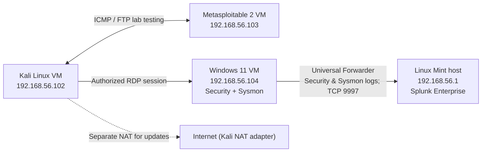

# Cybersecurity Homelab | Blue Team & SOC Portfolio

**Dylan Alexander** · Independent cybersecurity projects · [Architecture](docs/architecture.md) · [Evidence standards](docs/evidence-handling.md)

This portfolio documents **four completed, authorized homelab investigations** focused on security monitoring, network analysis, vulnerability assessment, and digital forensics. Each project includes its scope, methodology, findings, and limitations. The goal is to demonstrate evidence-based technical work relevant to **entry-level SOC Analyst and IT support roles**—not to present lab exercises as production security incidents.

## Start here: featured investigations

| Project | Investigation and demonstrated work | Evidence |
| --- | --- | --- |
| **[LAB-004 — Windows RDP Incident Simulation & DFIR](projects/LAB-004-incident-response-dfir-artifact-analysis/README.md)** | Correlated Windows Security **4624/4625** and Sysmon **1/11** in Splunk to reconstruct authorized RDP, PowerShell, and scheduled-task activity; exported `.evtx` logs and verified SHA-256 hashes after transfer | [Investigation report](projects/LAB-004-incident-response-dfir-artifact-analysis/reports/investigation-report.md) |
| **[LAB-003 — Splunk Security Monitoring](projects/LAB-003-splunk-security-monitoring/README.md)** | Wrote and tested SPL detecting **three reported sudo password failures** in a five-minute bucket; confirmed a scheduled medium-severity alert triggered | [SPL rule](projects/LAB-003-splunk-security-monitoring/detections/repeated-sudo-failures.spl) · [Report](projects/LAB-003-splunk-security-monitoring/evidence/investigation-report.md) |
| **[LAB-002 — VSFTPD Vulnerability Assessment](projects/LAB-002-vsftpd-vulnerability-assessment/README.md)** | Enumerated FTP service using Nmap; evaluated vsftpd 2.3.4's association with CVE-2011-2523 without claiming the backdoor was confirmed | [Enumeration output](evidence/reports/vsftpd/ftp-enumeration.txt) · [Report](evidence/reports/vsftpd/report.md) |
| **[LAB-001 — Network Traffic Analysis](projects/LAB-001-network-traffic-analysis/README.md)** | Captured ICMP and UDP/137 traffic with tcpdump, applied BPF filters, and distinguished baseline observations from uncertain NBNS interpretations | [Methodology and findings](projects/LAB-001-network-traffic-analysis/README.md) |

> **Reviewers:** LAB-004 and LAB-003 are the most relevant starting points for SOC detection, event correlation, and reporting. LAB-001 and LAB-002 document the networking and assessment foundations.

## Selected technical competencies

- **SIEM and detection:** Splunk Enterprise, Splunk Processing Language (SPL), scheduled alert validation, Linux authentication log analysis.
- **Windows investigation:** Windows Security events 4624/4625, logon types 3/10, Sysmon process/file telemetry, RDP activity correlation, PowerShell and Windows scheduled-task artifacts.
- **DFIR evidence handling:** `wevtutil` native `.evtx` exports, incident timeline construction, SHA-256 copy-integrity verification, documented confidence limits.
- **Network and vulnerability assessment:** tcpdump, BPF filters, ICMP, UDP/137, Nmap enumeration, CVE research, basic risk and remediation analysis.
- **Lab infrastructure:** Linux Mint, Kali Linux, Windows 11 Enterprise Evaluation, Metasploitable 2, VirtualBox host-only networking, Git and GitHub.

**Scope:** These skills were demonstrated in personal laboratory exercises. Tool installation alone is not represented as proficiency, and none of the simulated activity constitutes a real-world compromise or professional SOC employment.

## Lab environment

The documented investigations use a Lenovo ThinkPad T480 running Linux Mint 22.3 as the VirtualBox host. The core lab network is **192.168.56.0/24** (host-only).

The diagram shows the **documented deployed components** and selected investigation data flows, not an enterprise segmentation or firewall architecture. Full details: [docs/architecture.md](docs/architecture.md).

## Investigation standards

Each LAB-NNN project records its objectives, systems and tools, procedures, evidence, findings, limitations, and conclusions. Findings are distinguished from hypotheses; observed behaviors are not treated as proof of malicious intent without supporting evidence.

- All activity occurred against owned/authorized laboratory systems.
- LAB-002 identified a software-version association; **exploitation and backdoor presence were not confirmed**.
- LAB-003 and LAB-004 used **authorized simulations**; no unauthorized compromise is claimed.
- LAB-004's unredacted `.evtx` exports are retained privately rather than uploaded to GitHub. Hash equality verifies copies against a recorded baseline, **not** pre-acquisition immutability.
- See [evidence-handling.md](docs/evidence-handling.md) for publication and verification boundaries.

## Roadmap and limitations

- LAB-001: preserve and analyze a future PCAP in Wireshark (not performed in the documented exercise).
- LAB-003: evaluate detection tuning, fixed-bin window boundaries, and additional authentication sources.
- Future work: expand endpoint telemetry investigations and build more analyst-style alert-triage exercises.

**Portfolio owner:** Dylan Alexander · [GitHub profile](https://github.com/1-Dylan-Alexander)

