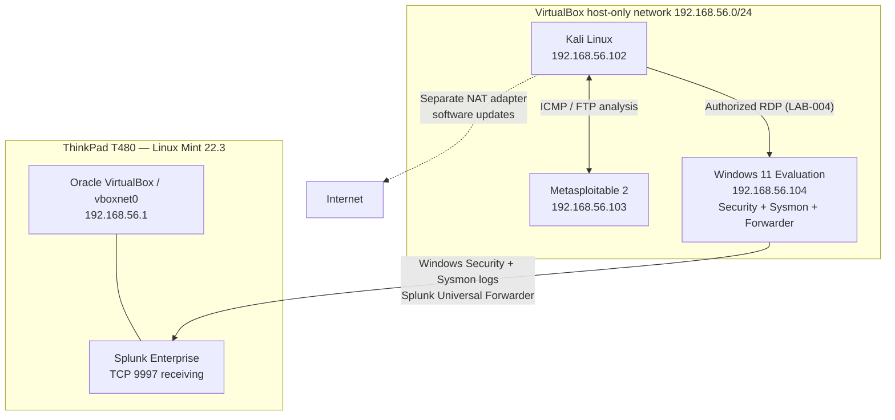

# Cybersecurity Homelab — Implemented Architecture

[← Portfolio home](../README.md) · [Evidence standards](evidence-handling.md)

**Scope:** Documented configuration supporting LAB-001 through LAB-004 (October 2026). This is an **implemented homelab topology**, not a proposed enterprise architecture. The host-only network is for authorized experiments.

## Components and roles

| System | Observed role | Network information |
| --- | --- | --- |
| Lenovo ThinkPad T480, Linux Mint 22.3 | VirtualBox hypervisor; Splunk Enterprise 10.6.0.5; evidence-transfer host | VirtualBox host-only adapter `vboxnet0`: `192.168.56.1` |
| Kali Linux VM | Packet capture, FTP assessment, authorized RDP client | Host-only `192.168.56.102`; separate NAT adapter used for internet/package access |
| Metasploitable 2 VM | Intentionally vulnerable, authorized FTP test target | Host-only `192.168.56.103` |
| Windows 11 Enterprise Evaluation VM | RDP endpoint and Windows Security/Sysmon telemetry source | Host-only `192.168.56.104` |
| Splunk Universal Forwarder (Windows VM) | Sends Windows Security and Sysmon Operational events | Splunk receiver: `192.168.56.1:9997` |
| Removable DFIR USB | Retains private copies of exported event logs and hash manifest | Offline evidence-transfer destination, not a SIEM or VM |

## Logical topology

## Investigation-specific data paths

### LAB-001 and LAB-002 — network and FTP assessment

1. Kali and Metasploitable communicate over VirtualBox host-only networking.
2. LAB-001 uses tcpdump to observe ICMP and UDP/137 traffic; it did **not** save a PCAP or complete Wireshark inspection.
3. LAB-002 uses Nmap and a Metasploit vulnerability check to evaluate an FTP version association; it does **not** establish that the vsftpd backdoor was present or exploited.

### LAB-003 — Linux authentication monitoring

- Splunk Enterprise runs on the Linux Mint host and monitors the host's `/var/log/auth.log`.
- A saved SPL search extracts reported failed sudo password counts and groups results in fixed five-minute buckets.
- A scheduled, medium-severity Splunk alert was confirmed to trigger during a controlled simulation.
- [Detection details](../projects/LAB-003-splunk-security-monitoring/README.md).

### LAB-004 — Windows endpoint investigation

1. Windows Security auditing and Sysmon were enabled on the Windows VM.
2. Splunk Universal Forwarder transmitted Security and Sysmon events to the host receiver at `192.168.56.1:9997`.
3. An authorized RDP client on Kali communicated with Windows through the host-only network. The Windows RDP firewall rule was restricted to Kali's lab IP for this exercise.
4. Security and Sysmon telemetry were correlated in Splunk to reconstruct the authentication, PowerShell, and benign scheduled-task sequence.
5. The operator exported `Security` and Sysmon `.evtx` logs using `wevtutil`, hashed them on Windows, transferred the files using a temporary VirtualBox shared folder, copied them to dedicated removable media, and compared SHA-256 hashes after transfer.

## Boundaries and limitations

- Host-only networking provides lab connectivity; it does **not**, by itself, demonstrate an enterprise-grade firewall, VLAN scheme, or DMZ.
- This drawing illustrates the relevant implemented components; it is not a full physical or packet-flow inventory.
- LAB-004 was a controlled simulation with authorized credentials, not an incident involving an actual adversary.
- Raw Windows event-log exports and their complete manifest are intentionally **not** stored in the public repository. See [evidence standards](evidence-handling.md).
